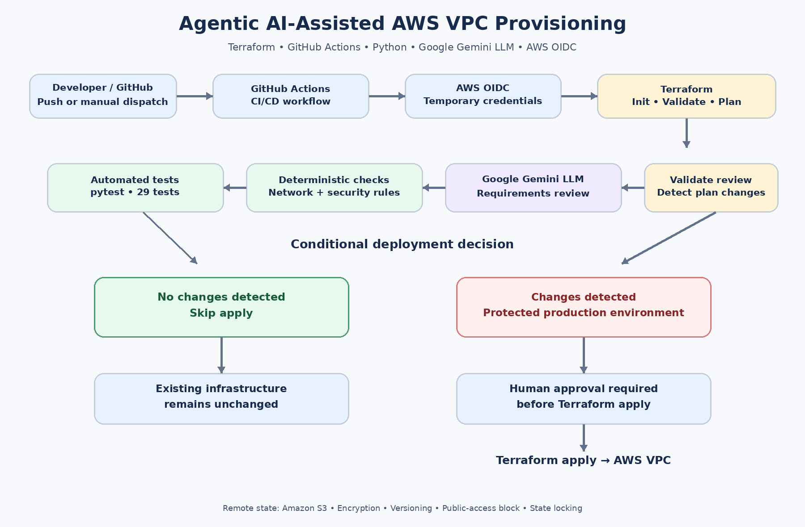
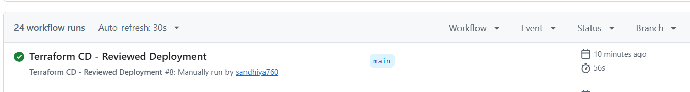

# Agentic AI-Assisted AWS VPC Provisioning & DevOps Automation

A security-focused Infrastructure as Code (IaC) project combining **Terraform, AWS, GitHub Actions, Python, and Google Gemini (LLM)** to validate infrastructure requirements, review proposed changes, and control deployment through automated checks and human approval.

## Problem Statement

Cloud infrastructure is often provisioned through manual steps or automation that focuses on whether configuration is syntactically valid, without sufficiently checking whether the proposed infrastructure meets security and networking requirements. Misconfigured routes, subnet layouts, or security-group rules can introduce unwanted exposure. AI-based reviews alone can also be inconsistent, while unattended deployment can apply changes without an explicit human checkpoint.

The problem addressed by this project is:

**How can AWS VPC provisioning be automated with Infrastructure as Code while checking explicit networking and security requirements, using an LLM to assist with plan review, and requiring human approval before infrastructure-changing deployments?**

## Solution

This project implements a GitHub Actions CI/CD workflow around Terraform. It runs automated tests, authenticates to AWS using GitHub Actions OpenID Connect (OIDC), validates Terraform, creates a plan, runs deterministic Python checks, and invokes **Google Gemini as the Large Language Model (LLM)** for requirements review. The review response is validated before the workflow continues. If checks or the mandatory AI review fail, the workflow blocks progression. If the plan has changes, the protected `production` environment provides a human approval gate before apply. If no changes are detected, apply is skipped.

## Architecture



## Role of the LLM: Google Gemini

**LLM used:** Google Gemini  
**Python integration:** Google GenAI SDK (`google-genai`)

Gemini is used for AI-assisted requirements review. The workflow supplies infrastructure requirements and Terraform configuration/plan evidence for review. The model helps assess whether the proposed infrastructure appears to satisfy the stated requirements and produces a structured review result.

The LLM is **not** responsible for provisioning resources or independently authorizing deployment. Python validates the review output, deterministic checks enforce explicit rules, and the protected GitHub environment supplies the human approval step.

### Why combine an LLM with deterministic checks?

| Component | Responsibility |
|---|---|
| Google Gemini LLM | AI-assisted comparison of requirements with infrastructure evidence |
| Deterministic Python checks | Enforce explicit networking and security rules |
| Review validation | Rejects malformed or incomplete review output and unsatisfied blockers |
| Human approval | Gates infrastructure-changing deployment |
| Terraform | Plans and applies infrastructure changes |

This layered design avoids relying on an LLM as the only security control.

## AWS Infrastructure

The Terraform configuration defines:

- **VPC:** CIDR `10.0.0.0/16`
- **Two public subnets:** In distinct Availability Zones, with public IP assignment enabled
- **Two private subnets:** In distinct Availability Zones
- **Internet Gateway:** Supports internet routing for public subnets
- **Route tables:** Separate public and private routing
- **Security group:** No inbound rules by default
- **Amazon S3 remote state:** Encryption, versioning, public-access blocking, and Terraform state locking

Private subnets are configured without a NAT Gateway or default internet route. This keeps the learning project cost-conscious and limits default outbound internet connectivity from private subnets.

## Technology Stack

| Category | Technology |
|---|---|
| Cloud platform | Amazon Web Services (AWS) |
| Infrastructure as Code | Terraform |
| CI/CD | GitHub Actions |
| LLM | Google Gemini |
| LLM SDK | Google GenAI Python SDK (`google-genai`) |
| Automation and validation | Python |
| Testing | pytest |
| AWS authentication | GitHub Actions OIDC and AWS IAM roles |
| Remote Terraform state | Amazon S3 with native state locking |

## CI/CD Workflow

1. Check out the repository commit.
2. Install Terraform and Python dependencies.
3. Run automated Python tests.
4. Authenticate to AWS using GitHub OIDC and temporary credentials.
5. Initialize and validate Terraform.
6. Generate the Terraform execution plan.
7. Run deterministic infrastructure and security checks.
8. Run the mandatory Gemini LLM requirements review.
9. Validate the structured review result and blocking requirements.
10. Detect whether the plan contains infrastructure changes.
11. Skip apply when no changes are detected.
12. When changes are detected, require approval through the protected `production` GitHub environment before applying the reviewed plan.

## Security and Governance

- **OIDC authentication:** Uses short-lived AWS credentials rather than long-lived AWS access keys stored in GitHub.
- **Fail-closed review:** A failed or invalid mandatory requirements review blocks progression.
- **Deterministic validation:** Explicit checks assess requirements such as VPC CIDR, subnet segmentation, routing, NAT/default-route expectations, and SSH exposure.
- **Human approval:** A protected GitHub environment is required before an infrastructure-changing plan can be applied.
- **Remote state protections:** S3 encryption, versioning, public-access blocking, and state locking.
- **Cost-aware design:** No NAT Gateway or EC2 instance is required for the core VPC provisioning workflow.

## Verified Results



The documented successful workflow run was **Terraform CD – Reviewed Deployment, run #8**, on branch `main`, commit `216e75b`.

Verified results from the run and local test output:

- GitHub Actions workflow: **Success**
- Automated Python tests: **29 passed**
- Terraform validation: **Passed**
- Deterministic requirements checks: **Passed**
- Gemini LLM requirements review: **Passed**
- Infrastructure change detection: **Completed**
- Apply stage: **Skipped because no infrastructure changes were detected**

**Scope of this result:** this run demonstrates the successful no-change path of the workflow. It does not demonstrate that a plan containing infrastructure changes was applied. The apply stage was skipped, so no infrastructure modification was performed by this run.

## Project Structure

```text
agentic-aws-vpc-provisioning/
├── .github/
│   └── workflows/
│       └── deploy.yml
├── assets/
│   ├── architecture.png
│   └── github-actions-success.png
├── main.tf
├── requirements.json
├── approval_gate.py
├── deterministic_requirements.py
├── requirements_review.py
├── review_plan.py
├── test_approval_gate.py
├── test_deterministic_requirements.py
├── test_requirements_review.py
├── test_security_review.py
└── README.md
```

This lists the known core project files and README assets. Preserve any additional files that already exist in your local repository.

## Run Tests Locally

```powershell
python -m pytest -v
```

Latest reported local result: **29 passed**.

Optional checks:

```powershell
terraform fmt -check -recursive
git diff --check
```

## Key Learnings

- AWS VPC design, subnet segmentation, and route tables
- Terraform Infrastructure as Code and remote state management
- GitHub Actions CI/CD workflow design
- OIDC-based authentication between GitHub Actions and AWS
- Deterministic infrastructure security validation
- Google Gemini LLM integration for requirements review
- Structured AI output validation and fail-closed workflow behavior
- Human approval gates and conditional deployment

## Future Improvements

- Add infrastructure drift detection.
- Expand deterministic policy checks for more AWS security controls.
- Publish a sanitized plan/review summary as a workflow artifact.
- Add monitoring and operational visibility for deployed workloads.

## Repository

[View the project on GitHub](https://github.com/sandhiya760/agentic-aws-vpc-provisioning)

> **Disclaimer:** This is a learning and portfolio project. Review IAM permissions, credentials, costs, and security controls before adapting it for production use.
